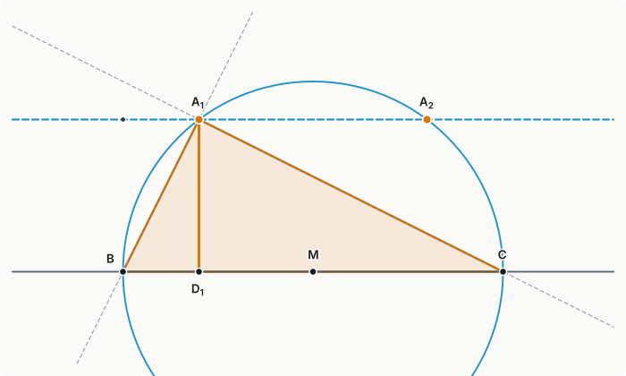

GEOMETOR • petersen
===================

**Visit the Online Archive:** https://geometor.github.io/petersen/

**Julius Petersen • Methods and Theories for Geometrical Constructions • semantic digital archive**

Mission
-------

``geometor/petersen`` is part of the interconnected `GEOMETOR <https://geometor.com>`_ semantic digital archive. It preserves and formalizes Julius Petersen's landmark 1866/1879 algorithmic treatise *Methods and Theories for the Solution of Problems of Geometrical Constructions, Applied to 410 Problems*. Through addressable semantic units, calibrated theme-adaptive vector diagrams, primary-source folio provenance, and exact SymPy symbolic models, Petersen's systematic taxonomy of geometric loci, similitude, parallel translation, rotation, and circle inversion connects Euclidean synthetic heuristics to modern constructive computation across the GEOMETOR corpus.

Books in This Archive
---------------------

- `Methods and Theories for Geometrical Constructions <https://geometor.github.io/petersen/methods_and_theories/>`_ — Systematic algorithmic treatise classifying ruler-and-compass problem-solving by geometric loci, transformations, and algebraic analysis (1879).

Heuristic Taxonomy & Symbolic Constructors
~~~~~~~~~~~~~~~~~~~~~~~~~~~~~~~~~~~~~~~~~~

- **Loci of Points & Lines** (``geometor.petersen.loci``): Circles of Apollonius, radical axes, and tangential envelope reductions.
- **Transformations of Figures** (``geometor.petersen.transformations``): Parallel translations, axial reflections, pivot-point spiral revolutions, and homothety from centres of similitude.
- **Inversion & Circle Systems** (``geometor.petersen.inversion``): Circle inversion, Malfatti/Gergonne systems, and quadratic radical-tower constructibility.

Repository Contents
-------------------

- ``docsrc/`` — RST documentation source, 3-track study codex, and Sphinx docs compiled by `PHOTON publish <https://github.com/photon-platform/publish>`_.
- ``resources/`` — Primary-source folios, 1879 English edition scans, and archival apparatus registries.
- ``src/geometor/petersen/`` — Exact SymPy symbolic patterns, transformation solvers, and geometric locus constructors.

Local Build & Verification
--------------------------

.. code-block:: bash

   publish build
   uv run --no-sync pytest

Part of the GEOMETOR Knowledge Archive
--------------------------------------

Explore all **74 Book Codices** and **11 Mathematical Catalogs** at https://geometor.com/books/.
